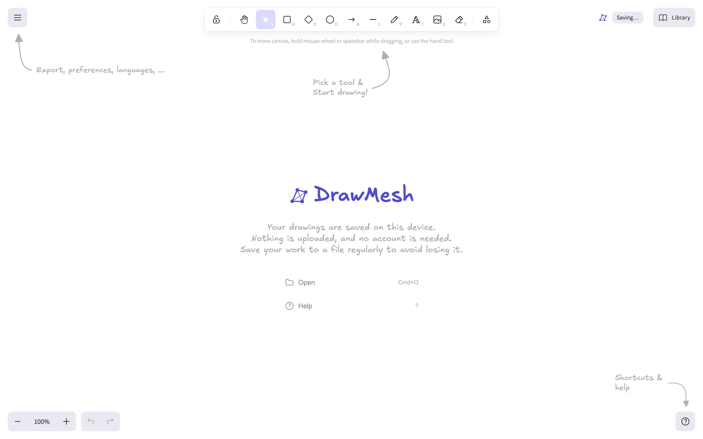
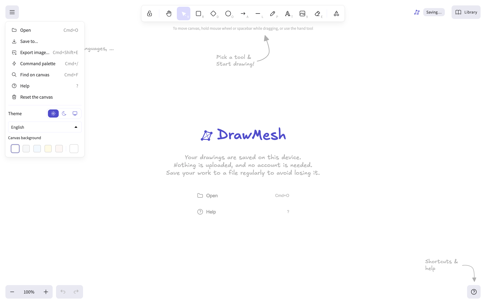
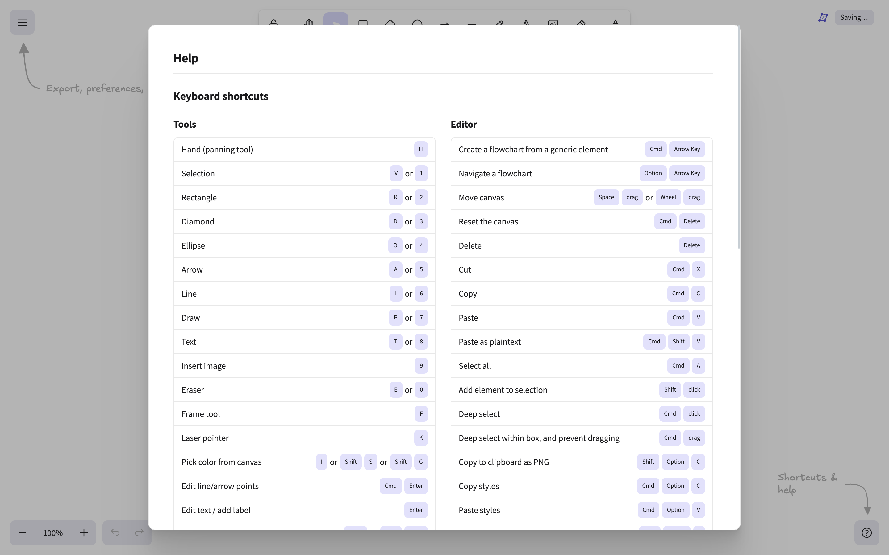
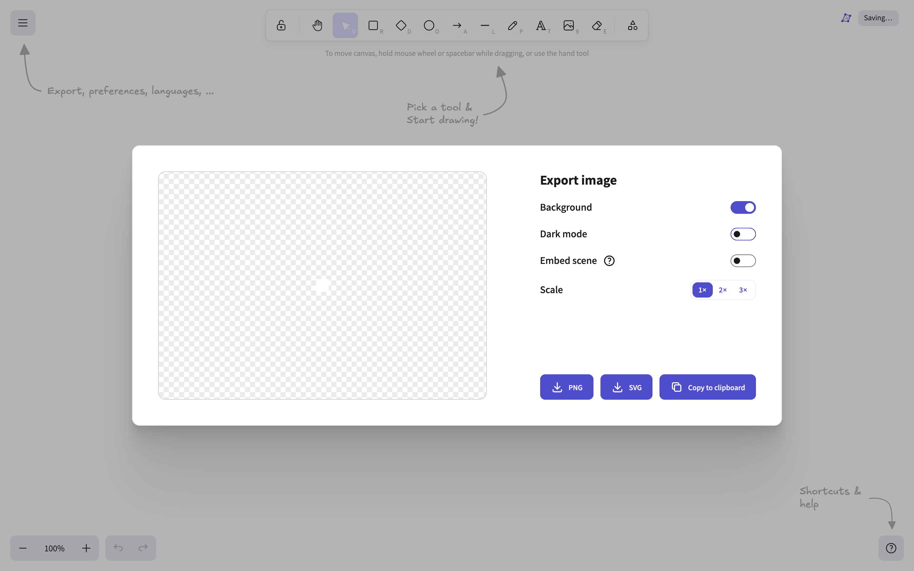
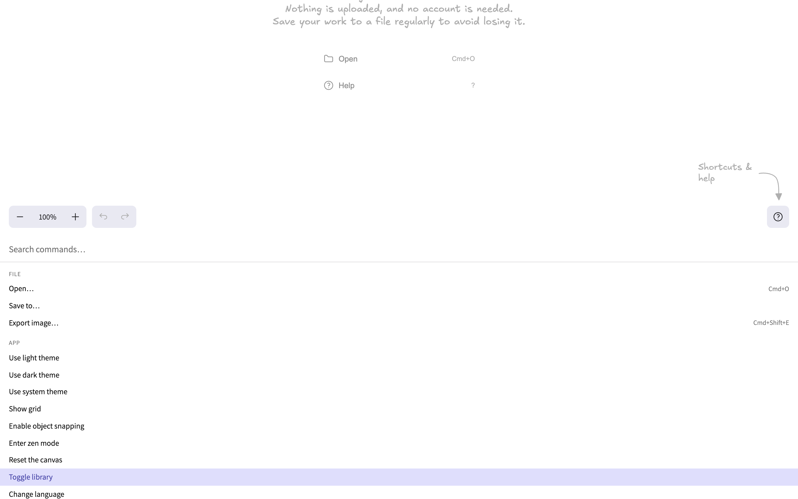
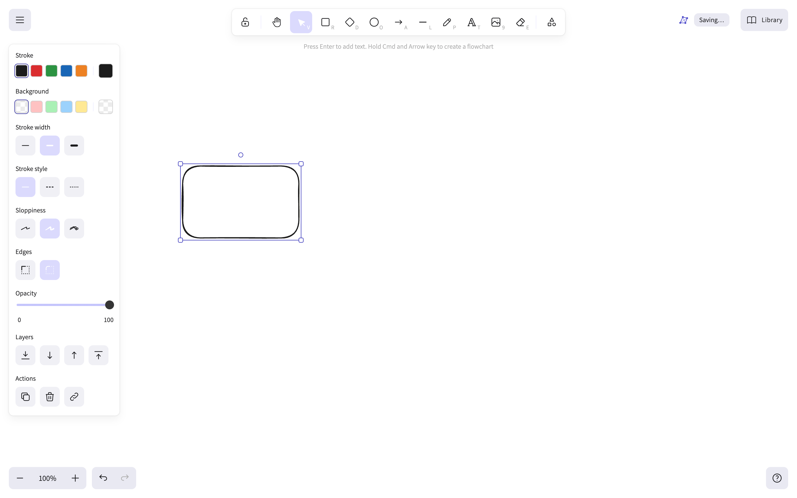

# DrawMesh

**A local-first, offline-capable whiteboard.** DrawMesh is an Excalidraw
board with the account, the share button, the live collaboration and the
public shape library taken out — and with everything else kept.

Your drawings never leave your device. There is no account, no server, no
telemetry and no network call you did not ask for. The app installs as a
PWA and keeps working with the network unplugged.

---

## Table of contents

- [Why this exists](#why-this-exists)
- [Credits and licensing](#credits-and-licensing)
- [What DrawMesh includes](#what-drawmesh-includes)
- [What DrawMesh removes](#what-drawmesh-removes)
- [Screenshots](#screenshots)
- [Getting started](#getting-started)
- [Using DrawMesh](#using-drawmesh)
- [Keyboard shortcuts](#keyboard-shortcuts)
- [Languages](#languages)
- [File formats](#file-formats)
- [Where your data lives](#where-your-data-lives)
- [Offline and installation](#offline-and-installation)
- [Parity with excalidraw.com](#parity-with-excalidrawcom)
- [Architecture](#architecture)
- [Project layout](#project-layout)
- [Scripts](#scripts)
- [Development](#development)
- [Verification](#verification)
- [Known limitations](#known-limitations)
- [Roadmap](#roadmap)

---

## Why this exists

[Excalidraw](https://excalidraw.com) is a remarkable piece of software: a
whiteboard that is fast, keyboard-driven, feels like paper and runs in a
browser tab. It is also, by default, a service. Out of the box it asks you
to sign in, offers to share a drawing over a link, can host a live
multi-user session, and lets you pull shape collections from a public
library hosted on Excalidraw's own infrastructure.

For a lot of people that is exactly what they want. For a lot of other
people it is not — and there was no way to get the board without the
service. A diagram of your own infrastructure, a whiteboard with a
customer's whiteboard, a personal scratchpad, a board you would rather
not have anyone else able to reach, a laptop with no signal, a locked-down
corporate network, an air-gapped machine. All of those wanted the canvas
and not the account.

**DrawMesh is that canvas, and only that canvas.**

It is a *host application* for the Excalidraw drawing engine — not a
fork. The engine is consumed as the published
[`@excalidraw/excalidraw`](https://www.npmjs.com/package/@excalidraw/excalidraw)
package, so DrawMesh inherits every tool, every shortcut and every bug fix
upstream, and it can be rebuilt against a new release in an afternoon.

What DrawMesh adds on top of the package:

- **A local-first data model.** The scene, the library and your preferences
  live in IndexedDB on your machine. There is no account, no sync and no
  backend. The app autosaves continuously and restores the last session
  when you come back.
- **A DrawMesh shell.** A custom main menu, a custom welcome screen, a
  custom brand mark and a save-status indicator, all built from the
  package's own components so they stay pixel-identical to the reference.
- **A command palette.** The published package ships a command palette
  component but never renders it and does not export it, so DrawMesh
  implements its own on the package's own dialog markup.
- **An offline-first PWA.** Installable, precached, self-hosted fonts, and
  a service worker that keeps the board working with the network off.
- **A clean bill of health.** No Excalidraw links, no shape library, no
  telemetry, no third-party requests you did not trigger.

---

## Credits and licensing

DrawMesh is **not** an Excalidraw fork. It is a separate application that
uses the Excalidraw drawing engine as a dependency.

| | |
|---|---|
| **Upstream project** | [excalidraw/excalidraw](https://github.com/excalidraw/excalidraw) — MIT License, © The Excalidraw authors |
| **Engine package** | [`@excalidraw/excalidraw`](https://www.npmjs.com/package/@excalidraw/excalidraw) v0.18.1 |
| **This application** | DrawMesh — MIT License |
| **Canvas engine author** | The Excalidraw contributors, without whom none of this exists |

The canvas, the shapes, the hand-drawn rendering style, the fonts
(Virgil, Nunito, Excalifont, Assistant, …), the shortcuts, the libraries
and the file format are the work of the Excalidraw project and are used
here under its MIT licence. DrawMesh's own code — the shell, the storage
layer, the command palette, the PWA plumbing and the branding — is
original.

If you like DrawMesh, please consider supporting
[the Excalidraw project](https://github.com/excalidraw/excalidraw).

---

## What DrawMesh includes

Everything Excalidraw's board does, because it *is* the Excalidraw board.

### Drawing

- **Shapes** — rectangle, diamond, ellipse, and the hand-drawn *draw* tool
  (freehand), with three fill styles, three stroke styles, three
  sloppiness levels, three stroke widths, sharp or round line caps, and
  straight or rough edges.
- **Arrows and lines** — with arrowheads, binding to shapes, multi-point
  editing, and elbow / round / sharp routing.
- **Text** — with seven font families, resizable, alignable, and bound to
  shapes.
- **Sticky notes, images and frames** — including drag-and-drop of image
  files, image cropping and frame organisation.
- **Laser pointer** for pointing at things during a call.
- **Selection** — lasso, deep select, multi-select, transform handles,
  rotation, and grouping and ungrouping.
- **Editing** — copy, paste, duplicate, cut, delete, align and distribute,
  flip, z-ordering (bring to front / send to back and in between), locking
  elements, and grouping.
- **Canvas** — infinite pan and zoom, an optional grid, object snapping,
  zoom-to-fit and zoom-to-selection, and a zen mode.
- **Undo and redo** with a full history.

### Content

- **The library** — DrawMesh keeps your own shape library in local
  storage so you can reuse elements across drawings. (The *public* shape
  browser is removed; see [What DrawMesh removes](#what-drawmesh-removes).)
- **Mermaid** — turn a Mermaid diagram into editable Excalidraw elements
  straight from the toolbar.
- **Images** — paste, drop or insert image files; they are stored with the
  drawing.

### Files

- **Import** `.excalidraw` and `.excalidrawlib` files, by drag-and-drop or
  from the menu.
- **Export** the scene as a `.excalidraw` file, as a PNG, as an SVG, or to
  the clipboard as PNG — with background, dark mode, scale and embedded
  scene options.
- **Find on canvas** — search the text of every element.

### Interface

- **Themes** — light, dark, or follow the system.
- **Languages** — 55 locales (see [Languages](#languages)).
- **A command palette** (Cmd+/) that exposes every app command.
- **A help dialog** with the full keyboard shortcut list.
- **Context menus**, tooltips, and the Excalidraw settings you know.

### And the parts DrawMesh adds

- **Local-first autosave** to IndexedDB, with a visible save indicator.
- **Session restore** — reopen the board exactly where you left it.
- **A PWA** that installs to your home screen and works offline.
- **Self-hosted fonts**, so the app renders correctly with no network.
- **A DrawMesh welcome screen** that tells you where your work lives.
- **A DrawMesh main menu** with only the entries that make sense offline.

---

## What DrawMesh removes

| Removed | Why |
|----------|-----|
| **Sign up / sign in** | A local-first app has no user. |
| **Share / "export to a link"** | Sharing would mean uploading. The "Save to…" dialog only offers *Save to disk*. |
| **Live collaboration** | Requires a server, an account and a socket. |
| **"Try Excalidraw+" banner** | Points at a paid product. |
| **The shape library browser** | The public library is served from `libraries.excalidraw.com` and the `excalidraw-libraries` repository. DrawMesh has no such service, so nothing is ever fetched from it. The **Library** button, the **Library** sidebar tab and **Add to library** in the context menu are all gone. Your own local library still works. |
| **The help dialog's link header** | DrawMesh has no Excalidraw documentation, blog, issue tracker or YouTube channel to link to. The four buttons are removed and no `excalidraw` link exists anywhere in the document. |
| **Social links** (GitHub, Discord, X) | Same reason. |
| **Analytics** | The package's tracking is not wired up. |

Everything in the list above is removed deliberately. Nothing else is
missing.

---

## Screenshots

| | |
|---|---|
|  | **Welcome screen** — the DrawMesh mark, a local-first message, and *Open* / *Help*. |
|  | **Main menu** — open, save, export, command palette, find on canvas, help, reset, theme, language, canvas background. |
|  | **Help dialog** — the full shortcut list, with no links out. |
|  | **Export dialog** — PNG / SVG / clipboard, with background, dark mode and scale. |
|  | **Command palette** — every command, searchable. |
|  | **Canvas** — a selected shape with the properties panel. |

---

## Getting started

### Requirements

- **Node.js 20 or newer** (developed on 24) and npm.
- A modern browser. For the PWA and the service worker, a Chromium-based
  browser or Safari 16.4+.

### Install and run

```bash
git clone <your-fork-url> drawmesh
cd drawmesh
npm install
npm run dev
```

Open <http://localhost:5173>.

### Production build

```bash
npm run build     # → dist/
npm run preview   # serve the production build on :4173
```

`dist/` is a static bundle: serve it from any static host, or open it
behind a local web server. For the PWA to work the app must be served
over **HTTPS** (or `localhost`).

### Install as an app

With the production build served, open it in a Chromium-based browser or
Safari and choose **Install app** / **Add to Home Screen**. The app then
launches in its own window, with no browser chrome, and works offline.

---

## Using DrawMesh

### Your first minute

1. DrawMesh opens on the **welcome screen**. It appears whenever the
   stored scene is empty.
2. Click **Open** to load a `.excalidraw` file, or **Help** for the
   shortcut list.
3. Pick a tool from the toolbar and start drawing. The welcome screen
   disappears as soon as you create something.
4. Everything is saved as you go. The indicator in the top right says
   *Saving…* and then *Saved on this device*.

### The canvas

- **Pan** — hold <kbd>Space</kbd> (or the middle mouse button) and drag, or
  use the hand tool (<kbd>H</kbd>).
- **Zoom** — <kbd>Ctrl</kbd>/<kbd>Cmd</kbd> + scroll, or the zoom control in
  the bottom left.
- **Select** — <kbd>V</kbd>, then drag a box, or lasso around elements.
- **Move between elements** — <kbd>Tab</kbd> cycles the selection.
- **Context menu** — right-click an element or the canvas.

### The menu (hamburger, top left)

| Entry | What it does |
|-------|--------------|
| **Open…** | Load a `.excalidraw` file |
| **Save to…** | Download the scene as a `.excalidraw` file |
| **Export image…** | PNG, SVG or clipboard, with options |
| **Command palette** | Jump to any command (Cmd+/) |
| **Find on canvas** | Search the text of every element (Cmd+F) |
| **Help** | The full shortcut list (?) |
| **Reset the canvas** | Clear everything |
| **Theme** | Light / dark / system |
| **Language** | 55 locales |
| **Canvas background** | The background colour |

### The command palette (Cmd+/)

Type to filter, <kbd>↑</kbd>/<kbd>↓</kbd> to move, <kbd>Enter</kbd> to
run, <kbd>Esc</kbd> to close. It covers the file actions, the theme, the
grid and snapping, zen mode, undo/redo, zoom, find on canvas, the help
dialog and every tool.

### Files

- **Drag and drop** a `.excalidraw` file onto the canvas to open it.
- **Drop an image** to add it to the drawing.
- **Export** via the menu, or <kbd>Cmd</kbd>+<kbd>Shift</kbd>+<kbd>E</kbd>.

---

## Keyboard shortcuts

The complete list lives in the app (**Help** in the menu, or press
<kbd>?</kbd>). The most useful ones:

### Tools

| Key | Tool | Key | Tool |
|-----|------|-----|------|
| <kbd>V</kbd> / <kbd>1</kbd> | Selection | <kbd>L</kbd> / <kbd>6</kbd> | Line |
| <kbd>R</kbd> / <kbd>2</kbd> | Rectangle | <kbd>P</kbd> / <kbd>7</kbd> | Draw |
| <kbd>D</kbd> / <kbd>3</kbd> | Diamond | <kbd>T</kbd> / <kbd>8</kbd> | Text |
| <kbd>O</kbd> / <kbd>4</kbd> | Ellipse | <kbd>E</kbd> / <kbd>0</kbd> | Eraser |
| <kbd>A</kbd> / <kbd>5</kbd> | Arrow | <kbd>H</kbd> | Hand |
| | | <kbd>F</kbd> | Frame |

### Files and editing

| Shortcut | Action |
|----------|--------|
| <kbd>Cmd</kbd>+<kbd>O</kbd> | Open a file |
| <kbd>Cmd</kbd>+<kbd>Shift</kbd>+<kbd>E</kbd> | Export image |
| <kbd>Cmd</kbd>+<kbd>/</kbd> | Command palette |
| <kbd>Cmd</kbd>+<kbd>F</kbd> | Find on canvas |
| <kbd>Cmd</kbd>+<kbd>A</kbd> | Select all |
| <kbd>Cmd</kbd>+<kbd>C</kbd> / <kbd>X</kbd> / <kbd>V</kbd> | Copy / cut / paste |
| <kbd>Cmd</kbd>+<kbd>Z</kbd> / <kbd>Cmd</kbd>+<kbd>Shift</kbd>+<kbd>Z</kbd> | Undo / redo |
| <kbd>Delete</kbd> | Delete the selection |
| <kbd>Cmd</kbd>+<kbd>Delete</kbd> | Reset the canvas |
| <kbd>Shift</kbd>+<kbd>Alt</kbd>+<kbd>D</kbd> | Toggle the theme |
| <kbd>?</kbd> | Help |
| <kbd>Space</kbd> + drag | Pan the canvas |
| <kbd>Ctrl</kbd>/<kbd>Cmd</kbd> + scroll | Zoom |

---

## Languages

DrawMesh ships the same **55 locales** as the Excalidraw engine. Switch
between them in the main menu under **Language**, or with the command
palette ("Change language").

| | | | |
|---|---|---|---|
| English | العربية | Български | Català |
| Česky | Dansk | Deutsch | Ελληνικά |
| Español | Euskara | فارسی | Suomi |
| Français | Galego | עברית | हिन्दी |
| Magyar | Bahasa Indonesia | Italiano | 日本語 |
| Taqbaylit | Қазақ тілі | 한국어 | Kurdî |
| Lietuvių | Latviešu | ພາສາລາວ | Bahasa Melayu |
| Norsk bokmål | Nederlands | Norsk nynorsk | Occitan |
| ਪੰਜਾਬੀ | Polski | Português (Brasil) | Português (Portugal) |
| Română | Slovenčina | Slovenščina | Suomi |
| Svenska | Türkçe | Українська | ไทย |
| Tiếng Việt | 中文（简体） | 中文（繁體） | 日本語 |

The locale files are code-split and precached by the service worker, so
switching languages works offline too.

---

## File formats

| Format | Extension | Used for |
|--------|-----------|----------|
| Excalidraw scene | `.excalidraw` | The full scene — elements, app state and embedded images. DrawMesh reads and writes the standard format, so files are interchangeable with Excalidraw. |
| Excalidraw library | `.excalidrawlib` | A collection of library items. |
| PNG | `.png` | Raster export, with scale (1×/2×/3×), background and dark-mode options. |
| SVG | `.svg` | Vector export. |

Exported `.excalidraw` files open in Excalidraw and vice versa.

---

## Where your data lives

Everything is stored in **IndexedDB**, in the `drawmesh` database, using
[localForage](https://github.com/localForage/localForage):

| Key | Contents |
|-----|----------|
| `scene` | The current drawing, as a `.excalidraw` document. |
| `library` | Your personal shape library, as a `.excalidrawlib` document. |
| `preferences` | Theme, language and canvas background. |

Nothing is sent anywhere. The only outbound requests the app can make are
ones you asked for: loading a remote image you inserted, and fetching a
font that was not precached (the CJK face — see
[Offline and installation](#offline-and-installation)).

Clearing your browser's site data clears your drawings, so **export a
`.excalidraw` file** if a drawing matters to you. That is the same
trade-off Excalidraw makes, and the reason the welcome screen reminds you
to save regularly.

---

## Offline and installation

`vite-plugin-pwa` generates the service worker and the precache manifest.

- **Precached** — the app shell, the JavaScript and CSS chunks, every
  locale chunk, the icons and the Latin handwriting fonts.
- **Fetched on demand** — the CJK handwriting face is ~13 MB spread over
  200 subset files, so it is served from the local server but not
  precached. It is downloaded the first time CJK text is rendered, and
  the service worker keeps it afterwards.
- **Fonts are self-hosted.** The engine resolves its fonts through
  `window.EXCALIDRAW_ASSET_PATH`; without it the package would fetch them
  from a CDN. DrawMesh points it at `/` and serves the files from
  `public/fonts/`.

To try it: build, serve the build, install the app, then turn the
network off and reload. The board still comes up.

---

## Parity with excalidraw.com

DrawMesh is a pixel-level reimplementation of the Excalidraw board, not
an approximation. The process and the measurements are documented in
[`docs/parity-spec.md`](docs/parity-spec.md), and the reference and
DrawMesh screenshots live in `docs/reference/` and `docs/drawmesh/`.

```bash
node scripts/capture-ui.mjs docs/reference   # capture excalidraw.com
node scripts/capture-drawmesh.mjs            # capture DrawMesh
node scripts/compare-screenshots.mjs          # pixel diff
```

Current result: **5.65 % mean changed pixels** across seven views
(welcome screen in light and dark, main menu, help dialog, export dialog,
command palette and search sidebar). The residual difference is the
DrawMesh branding, the removed link header in the help dialog and the
elements the package version does not have yet.

Two deliberate patches bridge the gap between the published package and
the live site:

- `ToolbarKeybindingParity` renders the letter shortcut (`V`) on the
  toolbar instead of the number (`1`), exactly like the reference.
- `theme.css` overrides the brand hue and the modal scrim.

---

## Architecture

```
                 ┌──────────────────────────────────────────┐
                 │  DrawMesh shell                          │
                 │  ┌────────────┐ ┌──────────┐ ┌────────┐ │
                 │  │ MainMenu   │ │ Welcome  │ │ Command │ │
                 │  │            │ │ Screen   │ │ Palette │ │
                 │  └─────┬──────┘ └────┬─────┘ └───┬────┘ │
                 └────────┼──────────────┼───────────┼──────┘
                          │ tunnel        │ tunnel    │
                 ┌────────▼──────────────▼───────────▼──────┐
                 │  @excalidraw/excalidraw (the engine)      │
                 │  canvas · toolbar · properties panel ·      │
                 │  dialogs · library · i18n · file formats   │
                 └───────────────────────┬──────────────────┘
                                         │ onChange / onLibraryChange
                 ┌───────────────────────▼──────────────────┐
                 │  src/lib/scene.ts → serializeAsJSON      │
                 │  src/lib/storage.ts → localForage/IDB   │
                 └──────────────────────────────────────────┘
```

Two extension points do most of the work.

**1. The tunnel mechanism.** `children` passed to `<Excalidraw>` are
rendered inside the engine's own React contexts, and the engine routes
them into its chrome through *tunnels*. Rendering `<MainMenu>` therefore
replaces the built-in main menu; rendering `<WelcomeScreen>` replaces the
built-in welcome screen — both with the engine's own components, so the
result is pixel-identical.

**2. `renderTopRightUI`.** The engine renders this slot next to the
library trigger; DrawMesh puts its brand mark and save indicator there.

Everything else — the canvas, the toolbar, the properties panel, the
help and export dialogs, the library, i18n — comes from the engine
unchanged.

---

## Project layout

```
drawmesh/
├── docs/
│   ├── parity-spec.md         the parity specification and evidence log
│   ├── reference/             excalidraw.com reference screenshots
│   └── drawmesh/              DrawMesh screenshots
├── public/
│   ├── fonts/                 the engine's fonts, self-hosted (234 files)
│   ├── icons/                 PWA icons
│   ├── favicon.svg
│   └── logo.svg
├── scripts/
│   ├── lib/cdp.mjs            a tiny Chrome DevTools Protocol client
│   ├── capture-ui.mjs         capture the excalidraw.com reference
│   ├── capture-drawmesh.mjs   capture DrawMesh
│   ├── compare-screenshots.mjs pixel diff
│   └── verify.mjs             end-to-end checks
├── src/
│   ├── App.tsx                the canvas host, persistence, preferences
│   ├── components/
│   │   ├── CommandPalette.tsx
│   │   ├── DrawMeshLogo.tsx
│   │   ├── DrawMeshMainMenu.tsx
│   │   ├── DrawMeshTopRightUI.tsx
│   │   ├── DrawMeshWelcomeScreen.tsx
│   │   ├── RemoveExcalidrawLinks.tsx
│   │   └── ToolbarKeybindingParity.tsx
│   ├── features/commands.ts   the command registry
│   ├── hooks/                 preferences and save status
│   ├── lib/                   IndexedDB storage and scene (de)serialisation
│   ├── styles/                brand tokens and DrawMesh CSS
│   └── test/setup.ts
├── index.html
├── package.json
├── vite.config.ts
└── vitest.config.ts
```

---

## Scripts

| Command | What it does |
|---------|--------------|
| `npm run dev` | Development server on :5173 with hot reload. |
| `npm run build` | Type-check and build into `dist/`, including the service worker. |
| `npm run preview` | Serve the production build on :4173. |
| `npm test` | Unit tests (Vitest). |
| `npm run test:watch` | Tests in watch mode. |
| `npm run lint` | ESLint. |
| `npm run format` | Prettier (write). |
| `npm run format:check` | Prettier (check). |
| `npm run typecheck` | TypeScript, no emit. |

The `scripts/*.mjs` helpers need a Chromium listening on `CDP_PORT`
(default 9222). Any Chromium works:

```bash
"/path/to/Chromium" --remote-debugging-port=9222 --user-data-dir=/tmp/drawmesh-profile
```

---

## Development

### Stack

- **Vite 6** + **React 19** + **TypeScript 5.7**
- **`@excalidraw/excalidraw@0.18.1`** — the drawing engine
- **localForage** — IndexedDB with a localStorage fallback
- **Vitest** + **Testing Library** — unit tests
- **ESLint 9** + **Prettier 3**
- **vite-plugin-pwa** — the service worker and the web manifest

### Working on the shell

The engine owns the canvas, so the work is in the shell. The three things
you are most likely to change:

1. **`src/components/DrawMeshMainMenu.tsx`** — the menu. The engine's own
   `MainMenu.DefaultItems.*` are reused wherever possible so the styling
   stays identical; DrawMesh's own entries are added alongside.
2. **`src/styles/theme.css`** — the brand tokens. Everything the engine
   defines is inherited; only the brand hues and the modal scrim are
   overridden.
3. **`src/features/commands.ts`** — the command palette's registry.

### Upgrading the engine

The engine is pinned to an exact version. To move to a newer one:

```bash
npm install @excalidraw/excalidraw@<version>
npm run typecheck && npm test && npm run build
```

Then re-run the parity capture and read `docs/parity-spec.md` §10 for the
differences a new release brings.

---

## Verification

```bash
npm run build && npm run preview
node scripts/verify.mjs
```

`scripts/verify.mjs` drives the production build in a real Chromium over
the DevTools Protocol and runs **28 checks**:

- no Excalidraw branding, and no sign-up, share or live-collaboration
  entry anywhere;
- no `excalidraw` link in the document, and no link header in the help
  dialog;
- the main menu contains the expected entries and the preferences
  section;
- the toolbar exposes the reference tools and shows letter keybindings;
- the help, export and command-palette dialogs open, and the command
  palette opens from the menu and with Cmd+/ and closes with Escape;
- the library trigger, the library tab and "Add to library" are gone,
  while "Find on canvas" still opens the search sidebar;
- the scene is persisted to IndexedDB and survives a reload, and the
  welcome screen is hidden once a scene exists;
- the theme and the language switch;
- the web manifest is served, the service worker registers, the fonts
  resolve locally, and **the app shell and the canvas render with the
  network offline**.

`npm test` runs the unit tests (storage round-trips, the command
registry, the brand mark).

---

## Known limitations

These come from the published engine version, which is behind the live
excalidraw.com:

- **No sticky note tool** — newer than the published package.
- **The image tool is in the main toolbar** rather than the overflow
  menu, and the overflow trigger uses the engine's icon.
- **The help dialog** has no *sticky note* or *bucket fill* rows.
- The **shape library** is gone by design; the local library still works.

See [`docs/parity-spec.md`](docs/parity-spec.md) §11 for the full list.

---

## Roadmap

- [x] The board, the menu, the welcome screen and the branding
- [x] Local-first storage and session restore
- [x] The command palette
- [x] The PWA: installable, offline, self-hosted fonts
- [x] The Excalidraw-free shell: no account, no share, no library, no links
- [ ] Multiple drawings, with a recent-files list
- [ ] Import a folder of drawings
- [ ] Export to a self-hosted location you choose
- [ ] A "snapshot" command for a quick local history

---

## Licence

MIT.

The Excalidraw drawing engine is © the Excalidraw contributors and is
used under the MIT licence. See
[excalidraw/excalidraw](https://github.com/excalidraw/excalidraw) for the
full licence text.
